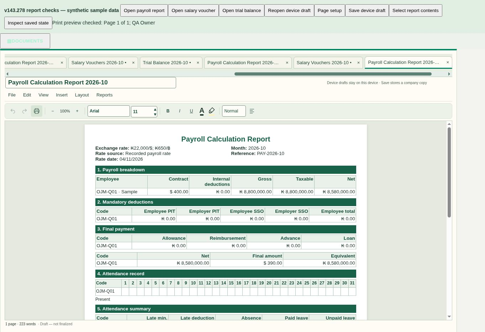

# Payroll closure, corrections and report layout — v143.278

Requested on 4 November 2026, including the follow-up exchange-rate and compact Print-button requests. This release addresses the eight confirmed gaps from the Verify Completed Changes review and preserves v143.277 monthly cash slips.

| Requested behavior | Delivered behavior |
| --- | --- |
| Close payroll before journaling | Close payroll saves to Salary History as Closed · Not journaled. |
| Edit closed payroll in an open month | Edit payroll reopens the saved snapshot without requiring an explanation. Journaling stays explicit; an existing open-month journal retains its ID. |
| Correct closed-month payroll safely | An explanation is required; original snapshots and journals remain available. The journal preview calculates a separate adjustment against the original and earlier adjustments. Unchanged amounts can finish with a correction report only. |
| Compact signatures | Centered short lines, with approximately 6.35 mm padding on both sides of the name; name and role below the line. |
| Editable actual roles | Manager, Director, Cashier and Employee suggestions, editable custom names/roles, and existing per-report defaults. Voucher receiver identity is preserved. |
| Centered titles | Generated payroll, salary voucher and financial-report titles are centered; saved report titles are normalized when opened. |
| Metadata above payroll breakdown | Rate/source/date on the left; month/reference on the right. Rate example: ₭22,912/$, preserving fractional values when present. |
| Clear journal actions | Save journal template saves the layout. Post to Active Journal requires explicit confirmation; Prepare in Transactions remains available. |
| More editor toolbar space | Print is fixed at 32 × 32 px. Adjacent controls stay close, and voucher/receipt actions no longer use an auto margin that pushes them to the far right. |

## Verification

- Twenty targeted Node suites passed: lifecycle SQL, workflow, report layout, payroll buttons/preparation/journal/reimbursements, report signatories/crossflows/overview/numeric protection/notices, monthly cash slips, contract/calculation rules, attendance explanations/calendar/details/workflows/reload, and payroll refresh.
- Isolated PostgreSQL tests cover rollback/retry, access restrictions, stale payroll and journal versions, original snapshots, frozen policies, retained leave carry while editing, same-ID open-month revisions, closed-month deltas and repeated adjustments. They never connect to the live ledger.
- Browser checks used synthetic payroll only: close into unjournaled History, reopen without a prompt in an open month, explicit posting confirmation and successful simulated posting, and a required reason after simulating month closure.
- Browser checks of the actual editor with production styles confirmed a 32 × 32 px Print button, compact formatted rate metadata, centered titles, short centered one-/three-person signatures, names below lines, editable names/roles retained after saving/reopening, and the editor print boundary with page numbering. The screenshot uses synthetic figures.
- Canonical build, source ownership/HTML references, changed cache keys, JavaScript syntax and release manifests checked. Release/source and offline cache versions are aligned.
- Migration `20261104092536_payroll_lifecycle277.sql` applied to Accounting. Payroll/journal row counts and content hashes were identical before and after the schema update. Private correction records have RLS and no client table grants; helpers are not client-executable. Five authenticated entry points enforce the existing active-admin/workspace/password checks. Advisory changes correspond to these five checked entry points and the intentionally inaccessible private table.

## Limits

No real payroll was closed, edited or posted as a test. Historical imports lacking saved calculation rules cannot be automatically recalculated; the UI explains that a reviewed manual adjustment is needed. Physical iPad/printing/scanning/offline behavior and recovery of earlier custom templates or month-specific financial corrections are not certified by this release. Legacy Playwright-only voucher/detail runners were unavailable in this environment; browser checks above used the supported browser instead.

