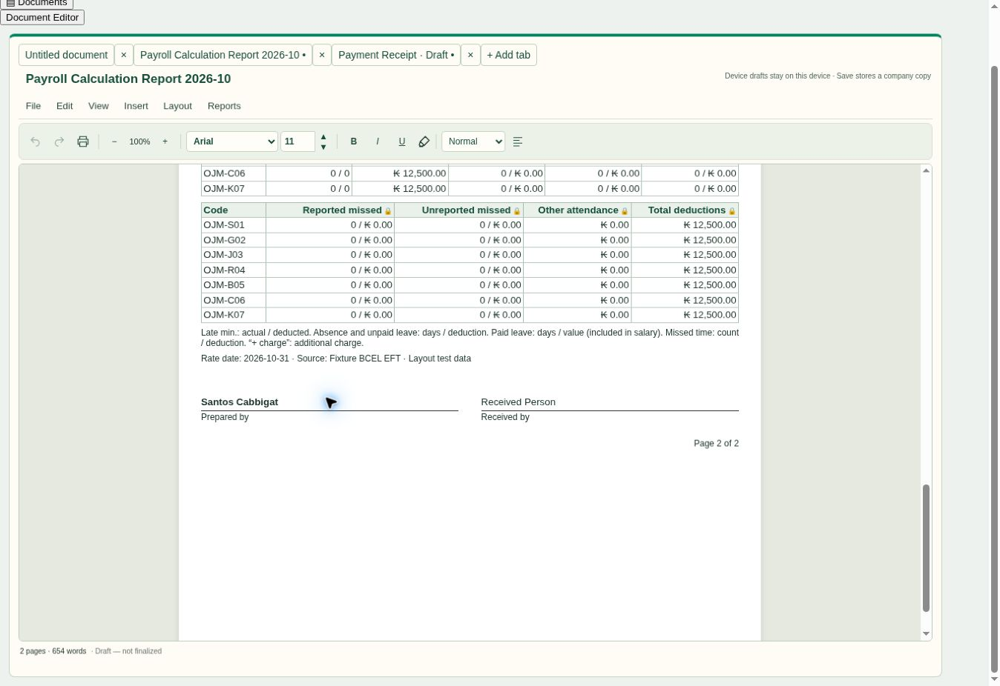

# Editor completion — v143.273

Opening a generated Payroll Calculation Report now protects its right-aligned calculated cells, shows lock icons in the editor, and places editable signatory names directly above their signature lines. Existing editable reports are migrated from their saved HTML; their financial values and notes are not regenerated from current payroll data. Typed names prefill the existing print-signatory chooser. Salary voucher receiver selection and identity checks remain in place.

This release also completes the previously prepared receipt/footer/sidebar changes. Footer position (bottom or after content) is independent of which pages show it. The sidebar sync-status panel is removed while the sync window retains feedback. Receipts retain seven rows and fractional LAK amounts, with Quantity, currency totals, editable receiver names and a preserved date underline. The account recovery/typing correction from v143.272 is retained. Updater, worker and changed-asset cache versions agree on v143.273.

## Verification

- Browser, actual editor source with isolated sample data: two-page payroll, 182 protected numeric cells; normal name replacement and Bold formatting on the line; select-all Backspace rejected; name and footer position retained after saving and reopening the browser draft.
- Browser: footer set to Immediately below content with last-page placement; one-page receipt, receiver typing, LAK/USD switching, fractional amount retained, and date selection preserving its underline. No runtime errors in those flows.
- Automated: payroll saved-copy migration/idempotence, selection/native-target guards, name formatting persistence, unrelated-document and voucher-identity preservation, receipt currency precision and sidebar removal with sync-window feedback retained.
- Existing payroll Overview/report, report notice and account draft recovery tests passed.
- Generated-source build/check, structure, release identity, cache-key and 412-asset diagnostics checks passed.

The screenshot below uses synthetic amounts from the existing repository fixture. It is not a screenshot of company payroll records.

Physical iPad/printer behavior and the user's installed browser cache were not inspected. This release does not certify payroll-to-journal accounting logic or recovery of missing browser-local custom templates. No financial records, payroll formulas, posted journals or retained issued PDFs were changed.
