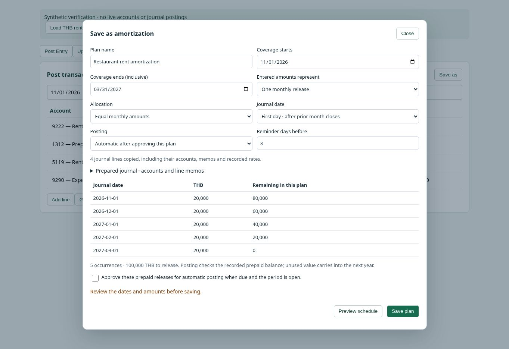

# Upcoming and prepaid amortization — v143.280

Post Entry → Save as offers Template, Recurring transaction and Amortization.
Existing accounts, descriptions, line memos, amounts and historical rates are
reused. Incomplete journals ask for missing information. A prepaid purchase is
converted into an expense release without copying its cash payment into every
month; the original purchase draft remains available for posting.

Upcoming contains Recurring, Amortization, To-dos and Calendar. Recurring includes
one-time scheduling and requires per-occurrence review. Amortization supports
equal monthly or daily allocations, total/monthly amount basis, an inclusive end
date, first/last-day journals, preview, pause/stop, history and optional approved
automatic posting. First-day posting waits for the previous month to close.

Foreign prepaid releases retain historical book value and the paired LAK mapping
in one transaction. No fresh spot-rate exchange gain/loss is generated. Rounding
preserves both the native amount and historical LAK total. Annual releases use
the current year's posted opening balance, preventing double-counted prior-year
assets. Separate AMO/REC IDs do not consume the normal OJM sequence.

The server checks admin/workspace/action permissions, active accounts, historical
valuation, open periods/years, available prepaid balance and immutable retries.
Approved amortization is checked after period transitions and daily at 00:10 Laos.
No browser polling is introduced. Private tables intentionally deny direct access
(no RLS policies); authenticated RPCs perform the permission checks. Unused index
advisories are expected for empty new tables.

Generate includes named Wi-Fi, house rent, THB restaurant rent, insurance and other
prepaid starters. Original custom template numbers and deletion tombstones remain
permanent. A single unambiguous retained device copy can restore missing content.
Four original custom template IDs survive in cloud numbering, but their bodies
are absent from cloud and legacy storage. This release does not claim recovery
of those unavailable originals. Conflicting retained copies require review.

Existing prepaid schedules and posted journals are unchanged. The old foreign
rent parts have different posting progress; reconcile and pause the old schedules
before activating a replacement. Overlap with active legacy prepaid schedules is
blocked. No live test journals or amortization plans were created.

Validation: pure schedule model tests; isolated PostgreSQL posting/security/worker
tests; 132 journal completion cases; Generate workspace ownership; template cloud
and retained-copy recovery; canonical build/structural/cache gates; browser
verification with synthetic data of prepared/blank/purchase flows, historical
THB generation, cross-year preview, post, and lost-response save retry.

