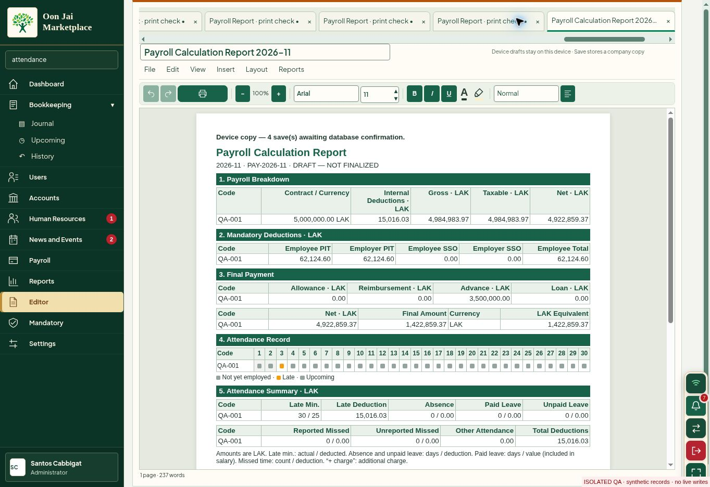

# Whole-app workflow review — v143.256

Date: 3 November 2026. Starting revision: a1cb1d1875ced246bf95149ce03f379bb590e4ab (v143.255).

This review opened every desktop main module, exercised the paths below through the browser, inspected rendered screens, and ran targeted calculation and persistence regressions. It is **not certification that every button, permission combination, device, or live integration works**. Opening a screen is recorded separately from completing a workflow.

## Defects reproduced and fixed

1. **Conflicting keyboard shortcuts did nothing.** Attendance/AI HR Inbox, Journal/Submitted Entries, and Profit Tax/Payments shared letters, while the handler required exactly one match. Distinct keys now work: HR A/I, Bookkeeping J/S, Mandatory P/Y. Duplicate initials in settings sections also receive distinct keys. Verified by actual browser key presses and regression tests across all navigation choices.
2. **The active document tab was hidden beyond the visible tab strip.** With many open documents, a newly opened payroll report was selected but its tab remained far off-screen. Opening/switching now reveals the selected tab horizontally; ordinary editing retains deliberate tab-bar scrolling. Actual browser check: selected tab moved from x=6352 (outside a bar ending at x=1296) into x=1051–1271. Tested stale animation callbacks and switching in both directions.

No financial formula, real salary amount, saved payroll note, posted entry, account permission, or production database record was changed by this release.

## Browser workflow coverage

All mutation tests used synthetic records in a separate preview with external writes blocked. Local saves awaiting database confirmation are not counted as confirmed server persistence.

| Area | Inspected screens | Actions exercised and results |
|---|---|---|
| Dashboard | Home, Finance, People, Operation, Compliance, Documents | Switched views and inspected layout, summary/empty states. Dashboard mapping edits were not exercised. |
| Users | Directory, Ryan Home, Journal, Summary, History, Ledger | Opened assigned cashbook, edited a synthetic existing line from 100 to 250, saved and verified unchanged entry ID and total 303→453. Summary and posted history rendered. Ledger server response was not represented by the fixture, so that backend path remains unverified. |
| Accounts | Chart of Accounts, Sub-accounts, groups | Expense filter and reset, Add Account validation/cancel, Manage Groups/Add Group/cancel, Add Sub-account/cancel. No live account/group edits or deletion. |
| HR employees | Employee list and editor | Created synthetic QA-001 with 5,000,000 LAK salary; reopened and edited position; saved and verified displayed result. |
| Attendance | Calendar, day editor, summary | Recorded 30 late minutes, saved day and attendance, inspected recalculated summary and 15,016.03 LAK deduction; Reload Saved Attendance exercised. Server durability is not certified. |
| Leave | Request form, review list, details | Saved a synthetic request after required reference validation. Approval correctly rejected zero available vacation allowance and retained pending status. |
| Performance | List and Add Assessment | Saved a synthetic assessment with date, reviewer, title and rating; verified resulting row. |
| Contracts | Contracts & Documents, Add Contract Record | Required end-date validation exercised; saved a synthetic reference with start/end dates and verified active row. Actual contract signing/upload was not performed. |
| AI HR Inbox | Review workspace | Inspected empty review, payroll-impact and audit panels; Google import and acceptance with real records remain unverified. |
| Payroll | Overview, Deductions, Entries, History | Entered synthetic 3,500,000 LAK advance, switched away/back, verified retained input and final payment 1,422,859.37 from net 4,922,859.37. Generated report in Editor. History empty state inspected. No production payroll finalization/payment. |
| Payroll report | Generated five-section report | Current advance and final payment agree; Code label and shortened attendance headings present; section 6/internal adjustments and the old 900,000 LAK note absent. Colors visible. Separate v143.255 checks covered print path, percentage image scaling, Save changes, X-close, storage failure/retry and full reload. Physical printer output remains unverified. |
| Bookkeeping journal | Journal, Submitted, Funds, Reconcile, Data Check, Closing, Budget, Voucher, AI Journal | Entry options and simplified double-entry selection, Add/Reset; submission/funding/closing/reconciliation views inspected. Added a synthetic 125,000 LAK budget item and verified row. No production posting, approval, closing, locking or deletion. |
| Upcoming | Schedule, Recurring, To-dos, Calendar | Opened scheduled-entry dialog, exercised empty required-field validation, cancelled. Inspected other views. Actual scheduled posting and reminders remain unverified. |
| History | Journal, User Entries, Budget Request, Audit Logs | Opened all views, inspected empty states, saved-submission rows, month controls and disabled pagination. Audit deletion/ID reuse not exercised on live data. |
| Reports | General Ledger, Trial Balance, Income Statement, Balance Sheet, Cash Flow, Reconciliation Reports, Account Activity, Expense, Payroll, User, Funding | Opened all 11 report screens. Cash-flow filters/account selection/Refresh exercised. Rendered layouts inspected where captured. Financial correctness tested independently with the model regressions below; an empty fixture is not evidence of real company balances. |
| Mandatory | Monthly Statutory, Profit Tax, Payments, Records | Opened all four; inspected filters, amounts, empty states, calculation fields and export actions. No live tax filing/payment or statutory-setting changes. |
| News and Events | News, Calendar, Account & Handover | News category switch and Open Calendar; added/saved a synthetic company event and verified calendar display. Handover controls inspected. External news feed and account transfer were not performed. |
| Company settings | Business information, Users & Permissions | Opened Ryan access editor and Account Assignment; verified default Single-entry cashbook and assigned fund controls; Done/Cancel. No permission, password, user deletion or deactivation writes. |
| Accounting settings | Defaults, Currency Manager, Vouchers, Google Drive and Sheets, Payroll, Mandatory | Opened every section; inspected fields, save actions, integration controls and numbering explanation. No live currency/numbering or tax-rule changes. |
| System & Tools | Accounting App, General preferences, Printing, Logo & banner, Installation & Handover, Google Accounting Archive, Portable Data Backup, Previous Local Audit Copy, Reset Operational Data, Recovery vault, Maintenance & Audit | Opened every section, inspected layout/action availability. Ran diagnostics in the fixture; its modified/missing assets and unavailable authenticated services prevent using that result as production health certification. Archive cleanup, operational reset, credential recovery and installation were not executed. |
| Editor | File, Edit, View, Insert, Layout, Reports menus; document tabs | Opened all six menus. Created a new document, changed title/body, saved, and verified explicit device-save/pending-database feedback. Report picker Close, new tab and active-tab visibility exercised. Import/export formats and every individual formatting command were not exhaustively exercised. |
| Shared controls | Global search, notifications, profile, keyboard navigation | Search “attendance” returned settings/page results and navigated to Attendance. Notifications opened/closed without marking items by opening alone. Profile opened/closed. Repaired HR, Bookkeeping and Mandatory keyboard routes verified. |

## Automated checks run

- `validation/test-workflow-audit256.cjs`: navigation uniqueness and real key-event dispatch, document-tab reveal, manual scrolling preservation, stale callbacks.
- `validation/test-payroll-contract234.cjs`: contract dates, proration, pre-employment days, holidays, half days, caps, grace, progressive penalties, finalized history.
- `validation/test-payroll-refresh235.cjs`: saved/draft payroll refresh, numeric normalization, employee roster changes, unsaved edits, month isolation and finalized records.
- `validation/test-work-schedule235.cjs`: saved schedules, effective dates, loaded-state protection.
- `validation/test-workspace-integrity252.cjs`: run/employee ownership, reordered rows, voucher consistency, header/footer database readback, removals, failure/retry and account changes.
- `validation/test-advance-edits253.cjs`: editable advance recalculation and current recovery wording without mutating saved notes or finalized data.
- `validation/test-report-filters143153.cjs`: eight filter panels, stable running balances, ordering and subtotal behavior.
- `validation/test-report-window143195.cjs`: exact-period fetch, opening totals, report models, cache behavior, account isolation and interrupted pagination.
- `validation/test-report-years143182.cjs`: cross-year/custom periods, no duplicate opening balances, valuation and state restoration.
- `validation/test-report-ui143154.cjs`: VAT source/month rules and report pagination exclusions.
- Required generated-source, runtime-structure, release-manifest and cache-key checks.

## Remaining verification limits

A full live end-to-end button audit is not completed. In particular, server-confirmed saves and cross-device synchronization; Google authorization/import/archive/export; real payroll finalization; journal posting/voiding/number reuse; account access changes; actual downloads/imports across formats; destructive recovery/cleanup; physical printing; and phone/tablet camera, touch, install, and offline-return behavior still need their own applicable environments and evidence.

The isolated preview deliberately lacks production authentication and several RPC responses. Its Word of Hope, ledger and diagnostic failures are recorded as fixture limitations, not claimed as production defects. Browser-extension errors are also not application findings. No synthetic records were written to production.

## Visual evidence

The screenshot uses only synthetic records. It shows the selected payroll tab visible at the right of an overflowing document strip, the current advance, five report sections and shortened headings.

