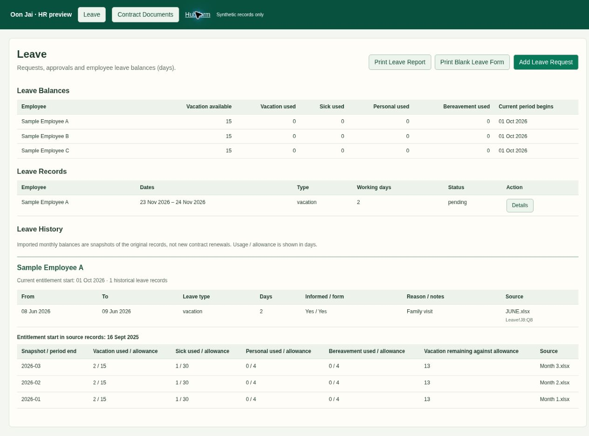

# HR leave and contract presentation — 143.460

Leave applications use a reusable A4 portrait layout based on the supplied paper form. Employee identity, dates, absence type, reason, accrued/used text, declarations, dates and supervisor comments remain structured values. The document editor supplies the configured company letterhead; leave records never contain a captured form image or generated page. New requests retain at most 31 daily work fractions rather than a copy of the entire company calendar. Approval recomputes the fractions before checking entitlement and preserves the original requested day total.

Leave balances use the full workspace. Imported history is presented as employee tables; source entitlement dates appear once per source period, while monthly snapshots remain individually identifiable. Current and historical dates are not rewritten. Contract Documents starts with all employees; filters and row actions keep the owning employee. Employees without a recorded contract remain visible with creation actions; no employment agreement is invented or signed.

Opening Add Leave Request mounts a separate dialog and retains unsaved fields when closed. It does not rebuild balances/history or request network data. HR navigation no longer performs a duplicate render. Hub inbox requests share one in-flight read and reuse the account-scoped result; explicit refresh and review refresh the inbox.

The additive database migration retains the existing public claim-submission flow and administrator-only review. The new form endpoint accepts only four short string answers (maximum 1 KB); unknown keys and images are rejected. Rejected claims remove free text and retain the existing compact decision record. The security advisor flags intentional public claim submission and signed-in RPC access; table RLS, no anonymous reads, active administrator review checks, existing version checks and payroll guards remain in place.

Validation: multi-employee leave, partial retry, overlaps, finalized payroll, annual accrual/grace, historical preservation and compact form/inbox unit checks. Browser preview used synthetic records for full-width history, dialog opening, A4 dimensions, all-contract default, employee filtering and row ownership. Live authenticated HR and physical-device response time were not verified; the available browser showed the sign-in screen. The retired test-hr-leave-balance143182 test references the removed HR inbox model; current vacation coverage uses test-vacation-grace456 instead.

Synthetic-record browser preview: 
